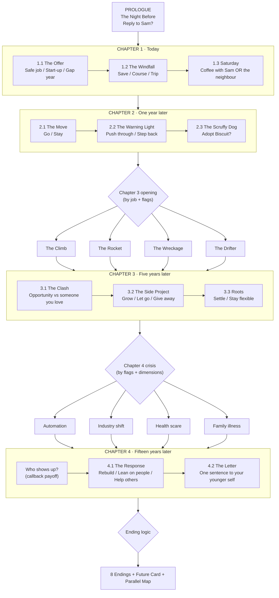

# Parallel Futures — Story Outline & Branch Map

| | |
|---|---|
| **Status** | Draft v1.0 |
| **Date** | 3 November 2026 |
| **Builds on** | [PRD.md](PRD.md) §6 |
| **Assumption** | General audience (aged 16–40). PRD open question 1 isn't answered yet, so the scenarios are kept universal. |

---

## 1. How the story works

- **12 decisions** per playthrough: Prologue 1, Chapter 1 3, Chapter 2 3, Chapter 3 3, Chapter 4 2.
- **Branch and merge:** every chapter opens on a shared beat. The *details* change with earlier choices, but the structure stays the same, which keeps the writing manageable.
- **Dimensions** (Security, Connection, Growth, Wellbeing, Impact) each start at **5** and are clamped between **0 and 10**. Effects below are written as `Sec +2`, `Con −1`, and so on.
- **Flags** are written in `code_style` and record specific choices so later scenes can call back to them.

### The secret thread
Notes signed **"— A."** turn up throughout the story. The player assumes **the Archivist** is a mysterious stranger. In the secret ending, the Archivist turns out to be **the player's future self**, who has been nudging them all along.

---

## 2. Branch map (overview)

---

## 3. Scene-by-scene outline

### PROLOGUE: The Night Before
*11:47 pm. Tomorrow you have to answer two job offers. On your doormat is a folded note in handwriting you almost recognise:*
> "Not every road is one you'll walk. Choose anyway. — A."

*Your phone buzzes. It's Sam, a friend you haven't spoken to since school: "Random, but I'm in town next week. Coffee?"*

| Choice | Effects | Flags |
|---|---|---|
| "Yes! Let's do it." | Con +1 | `sam_coffee` |
| "Leave it till tomorrow." *(you forget)* | none | `sam_ignored` |

> **Ripple hint:** "A small thing. Or is it?"

---

### CHAPTER 1: Today

**1.1 The Offer.** Two offers, one evening to decide.

| Choice | Effects | Flags |
|---|---|---|
| Northgate: steady salary, pension | Sec +2 | `job_safe` |
| Loop: 6-person start-up, chaos, equity | Gro +2, Sec −1 | `job_startup` |
| Neither. Go travelling for a year | Gro +1, Wel +1, Sec −2 | `gap_year` |

**1.2 The Windfall.** An unexpected £3,000 from a great-aunt you barely knew, with a note: *"Spend it on something that outlives me."*

| Choice | Effects | Flags |
|---|---|---|
| Save it | Sec +2 | `saved_windfall` |
| Take a course (coding / design) | Gro +2 | `learned_skill` |
| A trip with friends | Con +1, Wel +1 | `friends_trip` |

**1.3 Saturday** *(variant scene)*
- **If `sam_coffee`:** Coffee with Sam, who now runs a food bank and is short a Saturday driver.
  - Join in → Imp +2, Wel −1 · `volunteer`
  - Politely decline → Wel +1
- **If `sam_ignored`:** Your elderly neighbour, Rosa, is struggling up the stairs with shopping bags.
  - Help her (and stay for tea) → Imp +1, Con +1 · `helped_rosa`
  - Headphones on, keep walking → none

---

### CHAPTER 2: One Year Later
*The opening line reflects 1.1: "Northgate's lanyard is starting to feel like a collar…" / "Loop has run out of chairs and is running low on sleep…" / "Your backpack is held together with tape and stories…"*

**2.1 The Move** *(same choice, different flavour)*
- Safe job: a promotion if you move to head office.
- Start-up: Loop raises funding and opens a Lisbon office.
- Gap year: a hostel owner in Lisbon offers you a job.

| Choice | Effects | Flags |
|---|---|---|
| Go | Gro +1, Con −1 | `moved` |
| Stay | Con +1 | `stayed` |

**2.2 The Warning Light.** 3 am. Emails. Your heart is doing something odd. On the night bus home, a stranger in a grey coat says, *"You'll want to remember tonight."* Then they're gone.

| Choice | Effects | Flags |
|---|---|---|
| Push through. This is the moment | Sec +1, Gro +1, Wel −2 | `pushed_through` |
| Step back. Start saying no | Wel +2, Gro −1 | `stepped_back` |

**2.3 The Scruffy Dog** *(the "trivial" choice that ripples)*. A rescue-shelter van. One scruffy dog won't stop looking at you.

| Choice | Effects | Flags |
|---|---|---|
| Adopt him. His name is Biscuit | Wel +1, Con +1, Sec −1 | `dog_biscuit` |
| Not now. Life's too busy | none | none |

---

### CHAPTER 3: Five Years Later

**Opening variant** (the first match wins):

| Variant | Condition | Situation |
|---|---|---|
| **The Rocket** | `job_startup` + `pushed_through` + `learned_skill` | Loop is acquired. You get a life-changing payout. **Sec +3** |
| **The Wreckage** | `job_startup` (otherwise) | Loop folds overnight. You're starting again. **Sec −2** · `hit_bottom` |
| **The Climb** | `job_safe` | You manage a team now. Comfortable, and a little numb. |
| **The Drifter** | `gap_year` | Freelancing across three countries. Free, and never quite settled. |

**3.1 The Clash.** A big opportunity (a six-month project in Singapore) lands on the same week as something important to someone you love. *Who* it is depends on earlier choices:
- `dog_biscuit`: **Jordan**, the partner you met at the dog park, has a big life moment (a first art exhibition).
- else `sam_coffee`: **Sam's wedding**, and you're the best person.
- else: your **sister's** first child is due.

| Choice | Effects | Flags |
|---|---|---|
| Take the opportunity | Sec +2, Gro +1, Con −2 | `chose_career` |
| Show up for them | Con +2 | `showed_up` |

**3.2 The Side Project.** The thing you've built on the side (the version depends on your flags):
- `learned_skill`: an app that helps people swap and repair things.
- `volunteer`: a community kitchen that has grown out of the food bank.
- else: sourdough bread that sells out at the Saturday market.

| Choice | Effects | Flags |
|---|---|---|
| Grow it. Go all in | Gro +1, Imp +1, Wel −1 | `project_grew` |
| Let it go | Wel +1 | none |
| Give it away (open it up or hand it over) | Imp +2 | `gave_it_away` |

**3.3 Roots**
- If Sec ≥ 6: buy a small flat vs keep renting and stay flexible.
- If Sec ≤ 5: sign a long lease and commit to a place vs move back home for a while to regroup.

| Choice | Effects | Flags |
|---|---|---|
| Put down roots | Sec +2, Gro −1 | `settled` |
| Stay flexible / regroup | Gro +1, Wel +1 | `flexible` |

---

### CHAPTER 4: Fifteen Years Later

**The Crisis** (the first match wins):

| Crisis | Condition |
|---|---|
| **Health scare** | Wel ≤ 3 |
| **Automation:** your role at Northgate is replaced by software | `job_safe` and not `learned_skill` |
| **Industry shift:** your field reinvents itself overnight | `job_startup` or `gap_year` |
| **Family illness:** a parent needs care | otherwise |

**Who shows up?** This is the payoff scene, and the moment the player should realise early choices mattered. All matching callbacks play in order, up to two:
1. `sam_coffee`: **Sam** is at your door with soup and a plan.
2. `helped_rosa`: **Rosa's grandson**, now a nurse or recruiter, says *"My nan never stopped talking about you."*
3. `volunteer`: The **food-bank crew** organise a rota for you.
4. `dog_biscuit`: An old, grey-muzzled **Biscuit** rests his head on your knee (and Jordan, if `showed_up`).
5. `friends_trip`: The **group chat** from that trip lights up.
6. *No callbacks:* only a folded note on the doormat. *"You're not as alone as you think. — A."*

**4.1 The Response**

| Choice | Effects | Flags |
|---|---|---|
| Rebuild: learn, adapt, start again | Gro +2 | `rebuilt` |
| Lean on the people around you | Con +2, Wel +1 | `leaned_in` |
| Turn it into something for others | Imp +2 | `paid_forward` |

**4.2 The Letter.** The stranger in the grey coat returns: *"I can deliver one sentence to the night before it all began. Choose carefully."*

| Choice | Effects | Flags |
|---|---|---|
| "Reply to Sam." | none | `letter_sam` |
| "Take the risk." | none | `letter_risk` |
| "Rest more. Really." | none | `letter_rest` |
| "Don't change a thing." | none | `letter_nothing` |

> The letter doesn't change scores. It changes the **final line** of the epilogue and can unlock the secret ending.

---

## 4. Endings

### Ending logic (checked in order, the first match wins)

| # | Ending | Condition |
|---|---|---|
| 1 | **The Unexpected** *(secret)* | `letter_nothing` + `sam_coffee` + `volunteer` + `gave_it_away` + `paid_forward` |
| 2 | **The Phoenix** | `hit_bottom` (or a Health-scare crisis) + `rebuilt`, and Wel ≥ 5 |
| 3 | **The Golden Cage** | Sec ≥ 8 and Con ≤ 4 and Wel ≤ 4 |
| 4 | **The Balanced Life** | the highest dimension minus the lowest is ≤ 2 |
| 5–8 | **Top-two archetype** | the two highest dimensions (see below) |

| Archetype | Top two dimensions |
|---|---|
| **The Builder** | Security + Growth |
| **The Anchor** | Connection + Wellbeing |
| **The Wanderer** | Growth + (Wellbeing or Connection), with Security ≤ 4 |
| **The Quiet Hero** | Impact + (any) |

*Fallback for any other pair: the archetype of the single highest dimension (Sec→Builder, Con/Wel→Anchor, Gro→Wanderer, Imp→Quiet Hero).*

### Ending summaries

| Ending | Epilogue gist | Trade-off (so it's never preachy) |
|---|---|---|
| **The Builder** | You made things that last, and a home with your name on the door. | "You sometimes wonder what the other road looked like." |
| **The Anchor** | Your kitchen table is where everyone ends up. | "The big adventure stayed a postcard on the fridge." |
| **The Wanderer** | Five cities, three careers, a thousand stories. | "Home is a feeling you're still chasing." |
| **The Quiet Hero** | Strangers' lives are better and they'll never know why. | "You gave a lot. Did you save any for yourself?" |
| **The Golden Cage** | You have everything you planned for. | "The house is very quiet." |
| **The Phoenix** | You lost it all, and built something truer. | "The scars are part of the map now." |
| **The Balanced Life** | No headlines. A good life, evenly held. | "Not many people manage it. You did." |
| **The Unexpected** | The grey coat fits. The handwriting is yours. You sit down to write a note: *"Not every road is one you'll walk…"* | The loop closes. You were the Archivist all along. |

**Personalisation rule:** every epilogue includes at least **two callback sentences** pulled from flags (e.g. *"Biscuit's lead still hangs by the door."* / *"Sam still teases you about that 11:47 pm text."*), plus a **final line** from the letter choice.

---

## 5. Callback threads (the "decisions matter" checklist)

| Thread | Planted | Echo | Payoff |
|---|---|---|---|
| **Sam's text** | Prologue | 1.3 coffee, 3.1 wedding | Ch 4 shows up · secret ending |
| **Rosa** | 1.3 | none (deliberately forgotten) | Ch 4 grandson: the big surprise |
| **The windfall** | 1.2 | 3.2 side project, Ch 3 Rocket | Ch 4 crisis avoided or changed |
| **Biscuit** | 2.3 | 3.1 meeting Jordan | Ch 4 grey muzzle · epilogue line |
| **The grey coat** | Prologue note, 2.2 night bus | Ch 4 letter | Secret ending reveal |
| **Pushing through** | 2.2 | Ch 3 Rocket | Ch 4 health scare |

---

## 6. Content budget

| Element | Count | Words (approx.) |
|---|---|---|
| Scenes (incl. variants) | ~28 | ~2,200 |
| Ripple lines (one per choice) | ~34 | ~350 |
| Chapter-opening variants | ~10 | ~400 |
| Callback snippets | ~15 | ~400 |
| Endings (8 × epilogue + letter lines) | 8 + 4 | ~1,000 |
| **Total** | | **~4,350** (within the PRD's 4,000–6,000) |

A single playthrough shows about **1,400 words**, which fits the PRD's 1,200–1,800.

---

## 7. Next steps
1. Review this outline (tone, scenarios, the twist).
2. Write the full scene text and ripple lines.
3. Convert it to `story.json` using the PRD §10 data model.
4. Build the greybox prototype and playtest the branching and ending logic.
